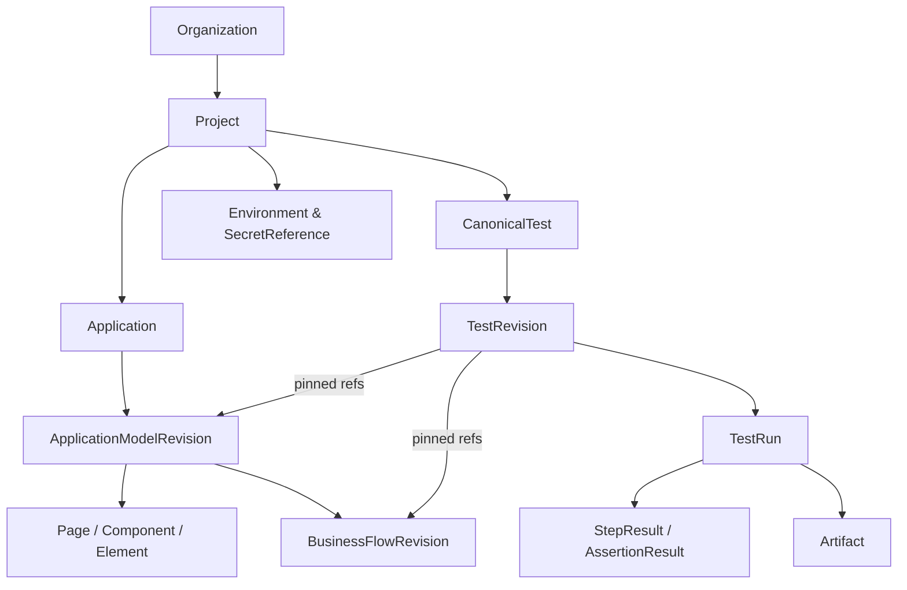

# 04 — Domain Model, Canonical Test ve API Sözleşmeleri

## Çekirdek varlıklar

| Varlık | Sahiplik | Yaşam döngüsü / önemli alanlar |
|---|---|---|
| Organization | sistem | id, name, status, retention policy |
| User, Membership, Role | organization/project | userId, orgId, projectId?, role |
| Project | organization | id, orgId, owner, status |
| Application | project | baseOrigin, allowlist, environmentId |
| Environment | project | URL, secretRef, execution policy |
| DiscoveryScan | application | requestedBy, budget, status, findings |
| AppModelRevision | application | immutable version; page/element/flow graph |
| Page, Component, Element | application model | semanticId, label, parent/child, locator candidate/evidence |
| BusinessFlowRevision | application model/project | typed action graph, params, pre/postconditions, refs |
| CanonicalTest | project | id, name, latestDraftId, latestPublishedId |
| TestRevision | test | immutable published definition, schemaVersion |
| Suite | project | list of test refs (post-MVP advanced orchestration) |
| TestRun | project/test revision | immutable snapshot; status, artifacts, expected/observed |
| StepResult, AssertionResult | test run | action ID, status, actual, expected, evidence pointer |
| Artifact | test run | screenshot/trace/log, checksum, ACL, retention |
| MappingSuggestion | application model | source evidence, candidate, reviewer, status |
| SecretReference | project/environment | vault reference, never value in test |
| AuditEvent | organization/project | actor, action, object, timestamp, diff metadata |

## İlişkiler



Her top-level row `organization_id` ile scoped; nested tablolarda project/application ownership doğrulanır. `TestRevision` asla başka org veya projedeki element/flow'u referanslayamaz. Tüm kullanıcı okuma/yazmaları ve background işler aynı tenant kontrollerinden geçer.

## Canonical model prensipleri

1. **Business intent = declarative/typed model**, serbest string veya framework kodu değil.
2. Published model immutable; draft üzerinde değiştir → validate → publish ile yeni revision.
3. Bir step'in semantic ID'si, params, action, targetRef, assertion/expected ve failure policy'si açık.
4. Flow/mapping referansları **revision pin** ile deterministic run için sabitlenir. New model change için explicit adopt/rebase işlemi gerekir.
5. Compiler `schemaVersion`, action catalog compatibility ve missing mappings denetimi yapar.
6. Runtime yalnızca compiler'ın ürettiği allowlisted Playwright actions set'ini çalıştırır; user-supplied arbitrary JS/eval MVP'de yok.
7. **Test has assertions:** PASS yalnız kapsamı açıkça bilinen assertion'lar çalışıp başarıyla sonuçlandıysa.

## Kanonik test örneği (tasarım şeması, üretim kodu değil)

```json
{
  "schemaVersion": "1.0",
  "testId": "test-login-dashboard",
  "revision": 3,
  "projectId": "project-alpha",
  "appModelRef": { "applicationId": "app-web", "revision": 7 },
  "title": "Geçerli müşteri giriş yapar",
  "preconditions": [
    { "kind": "secretExists", "ref": "secrets://staging/customerA" }
  ],
  "steps": [
    {
      "id": "step-1",
      "kind": "useBusinessFlow",
      "flowRef": { "id": "flow-login", "revision": 2 },
      "arguments": { "credentialRef": "secrets://staging/customerA" }
    },
    {
      "id": "step-2",
      "kind": "assert",
      "assertion": "elementVisible",
      "elementRef": "page.dashboard.header",
      "expected": true,
      "timeoutMs": 5000
    }
  ],
  "executionPolicy": { "onStepError": "stop", "maxDurationMs": 45000 }
}
```

Bu test **sadece dashboard'un görünürlüğünü** doğrular; bakiye doğrulaması içermez. Bakiye test edilmek isteniyorsa `elementText`/uygun iş kuralı assertion'ı ayrıca yazılmalıdır. `secretRef` örneği sözleşmeseldir; gerçek vault değerlerini barındırmaz.

## Business flow örneği

```json
{
  "id": "flow-login",
  "revision": 2,
  "name": "Geçerli müşteri olarak giriş yap",
  "inputs": ["credentialRef"],
  "actions": [
    { "kind": "navigate", "target": "page.login" },
    { "kind": "fillSecret", "target": "page.login.username", "source": "credentialRef.username" },
    { "kind": "fillSecret", "target": "page.login.password", "source": "credentialRef.password" },
    { "kind": "click", "target": "page.login.submit" }
  ],
  "postconditions": [{ "kind": "elementVisible", "target": "page.dashboard.header" }]
}
```

**Supported action catalog v1:** `navigate`, `click`, `fill`, `fillSecret`, `selectOption` (desteklenen native select), `assertVisible`, `assertText`, `assertURL`, `useBusinessFlow`. Loops ve arbitrary conditions hariç. `wait` genel amaçlı fixed sleep değil; locator ve assertion semantiği içinde explicit timeout.

## Element resolution

Her `Element` için `semanticId` ve kanıtlı locator adayları tutulur: `getByRole` + accessible name, `getByLabel`, `getByTestId`, stabil attribute ve scoped CSS en son. Locator tercihinde otomatik confidence etkendir ama tek kaynak değildir. 0 eşleşme → `not_found`; >1 → `ambiguous`; yanlış elementi seçip devam etmek yok. Browser locator generation heuristics yeniden gözden geçirilebilir ama expected result sessizce değişmez.

## Durum makineleri

**DiscoveryScan:** `queued → running → awaiting_review → approved/partially_approved` veya `failed/cancelled`.  
**TestRevision:** `draft → validated → published → superseded` (eski published immutable).  
**TestRun:** `queued → preparing → running → passed/failed/blocked/timed_out/infrastructure_error/cancelled`.  
**MappingSuggestion:** `proposed → accepted/rejected`; accepted creates **new AppModelRevision**, never patches prior run.

`blocked`: test çalıştırılamadı (eksik mapping/credentials). `failed`: ürün assertion'ı tutmadı veya yürütme adımı gerçek test hatasına uğradı. `infrastructure_error`: worker/browser setup problemi. Ayrım UI ve metriklerde korunur.

## API yüzeyi (REST v1, kavramsal)

```text
POST   /v1/projects
POST   /v1/projects/:id/applications
POST   /v1/applications/:id/discovery-scans
GET    /v1/applications/:id/model-revisions/:revision
POST   /v1/applications/:id/mappings/review
POST   /v1/projects/:id/business-flows
POST   /v1/projects/:id/tests
PATCH  /v1/tests/:id/draft
POST   /v1/tests/:id/validate
POST   /v1/tests/:id/publish
POST   /v1/tests/:id/runs                  [Idempotency-Key]
GET    /v1/runs/:id
GET    /v1/runs/:id/results
GET    /v1/runs/:id/artifacts             [authorized short-lived URLs]
POST   /v1/runs/:id/cancel
GET    /v1/projects/:id/audit-events
```

Her endpoint için typed request/response, tenant claims, error code ve openapi schema gereklidir. `PATCH draft` optimistic concurrency (`If-Match` veya revision) kullanır. `POST run` published test revision + app model revision + environment revision snapshot'ı alır, geri dönük mutasyon yapmaz.

## Database temel indeks ve tutarlılık kuralları

- UUID/ULID consistent ID standardı; `organization_id`, `project_id` FK ve index.
- Revision unique `(entity_id, revision)`; run index `(project_id, created_at desc)`, queue `(status, available_at)`.
- Immutable published definitions ve artifacts metadata; soft delete / retention policy.
- Audit append-only; değişen varlıkların old/new rev referansları.
- Tanımlanmamış cross-tenant FK yok; API ve DB seviyesinde ownership validation.
- Concurrency: run idempotency; worker claim `FOR UPDATE SKIP LOCKED` lease + heartbeat; outbox/inbox pattern gerekirse.

## Gelecek engine adapters

`compile(testRevision, appModelRevision, environment) → ExecutionPlan` saf/öngörülebilir modüldür. `ExecutionAdapter` sözleşmesi `{capabilities, execute(plan, context), collectArtifacts}` şeklindedir. İlk adapter Playwright Chromium; yeni engine geldiğinde test modelinin action semantic'leri korunur veya capability negotiation ile unsupported işaretlenir. `Selenium`, `Appium`, `API` adapterları **şimdilik yalnız tasarım uzatma noktası**, teslimat değildir.
