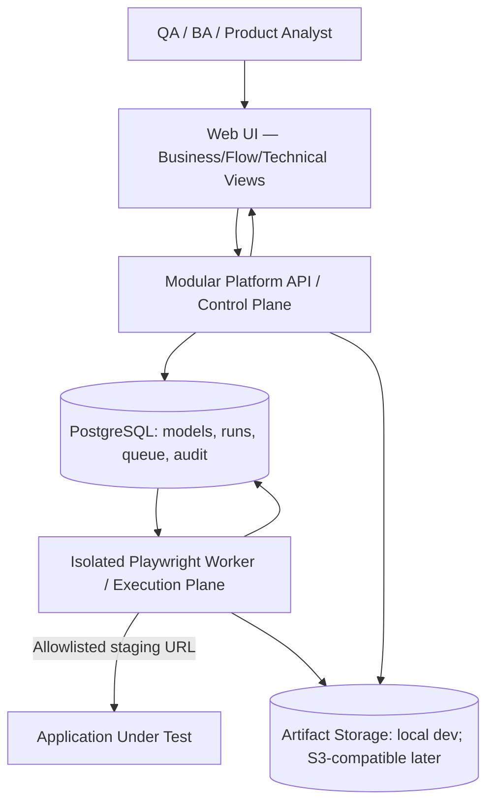

# 05 — Teknik Mimari, Güvenlik, Deployment ve Observability

## Mimari strateji

| Kriter | Modular monolith + worker | Microservices | Hybrid büyük platform |
|---|---|---|---|
| MVP geliştirme/operasyon | En basit | Ağır | Orta/ağır |
| Transaction ve domain tutarlılığı | Kolay | Dağıtık | Orta |
| Worker kaynak izolasyonu | Ayrı proses/container ile var | Var | Var |
| Ekip sayısı ihtiyacı | Küçük | Büyük | Orta |
| Sonraki ölçekleme | Modül çıkarılabilir | Doğrudan dağıtık | Var |

**ÖNERİ:** Kontrol düzleminde **modüler monolith**, browser execution için **ayrı worker proses/container**. Kubernetes ve bağımsız mikroservisler için somut baskı yok; ilk başta kurulmayacak.

## Sistem akışı

**Arayüz** ve **runner** farklı lifecycle; kullanıcı browser'ı test runner değildir. Browser'ı API process'inde başlatma.

## Önerilen teknoloji yığını — PROPOSED, ADR review gerekli

- **UI:** Next.js + TypeScript + erişilebilir component kit + Zod tabanlı form/schema validation.
- **API:** Fastify + TypeScript, tek servis içinde modüller (`identity`, `organizations`, `projects`, `application-discovery`, `application-model`, `test-design`, `runs`, `reporting`, `audit`).
- **Model/Compiler:** JSON Schema + typed TypeScript domain packages; published revision immutable.
- **Execution:** Playwright (Node/TypeScript), Chromium, her run için ayrı browser context; risk modeline göre worker başına tek run.
- **Database / queue:** PostgreSQL; basit persistent job table ve `SKIP LOCKED` claim/lease; MVP'de Redis, Kafka yok.
- **Artifacts:** dev local mounted volume; production pilot için S3-compatible private storage adapter. Signed URL kısa ömürlü ve auth kontrolü.
- **Packaging:** pnpm monorepo; Docker Compose local ve tek/az düğümlü pilot; CI ile versioned images.
- **Auth:** Kanıtlanmış auth/session kütüphanesiyle secure HttpOnly session cookie; framework/vendor seçimi discovery spike sonrası ADR. Parolalar Argon2id/bcrypt uygun parametrelerle; MFA/SSO V1 enterprise.
- **Observability:** structured JSON logs + requestId/runId/testId/orgId, temel metrics, trace reference; secret redaction.

## Modül sınırları / kontratlar

| Modül | Tek sorumluluk | Yapmaması gereken |
|---|---|---|
| Identity/Access | authenticate, authorize, membership | UI'da rol kontrolüne güvenmek |
| Application Discovery | deterministic, safe DOM metadata capture | Otonom purchase/delete/form submit |
| Application Model | sayfa/element/flow revision graph | Kullanıcının expected result'ını gizlice değiştirmek |
| Test Design | typed intents, schema validation, versioning | İçine raw Playwright kodu saklamak |
| Compiler | model → verified execution plan | Runner'da rastgele yeniden yorumlama |
| Runs/Queue | idempotent scheduling, state, leases | Browser process'i API'de çalıştırmak |
| Worker | izolasyon, execute, result/evidence | Başka tenant'ın secret'ına erişmek |
| Reports/Audit | immutable observed outcomes ve history | Inferred PASS üretmek |

## Execution lifecycle

1. `POST runs` → authz, published model ve app mapping snapshot validate.
2. `Run` `queued`; event + idempotency key aynı DB transaction'ında kaydedilir.
3. Worker run lease alır, job budget ve allowlist/secret scope check yapar.
4. Runner yeni isolated browser/context açar, compiler-produced plan'ı yürütür.
5. Step ve assertion sonuçları + screenshot/trace/console bulguları sanitized kaydedilir.
6. Atomic final status + evidence manifest + checksum commit edilir.
7. Worker crash olursa lease expire ve retry policy uygulanır; bir run iki kez finalize edilmez; retry ayrı attempt olarak görünür.

## Discovery execution ayrı güvenlik yolu

- `safe discovery` yalnız allowlisted staging origin/route. Read-only page load ve DOM/accessibility snapshot. **Click/form submission/navigating untrusted links default kapalı.**
- SPA/conditional content keşfi için kullanıcı guided teach modunda açıkça aksiyon yapar; test environment URL'sine yazma izinleri ayrıca kontrol edilir.
- Scan rate, page count, depth, time, CPU/memory, total artifact byte limitleri merkezi policy'de tutulur.
- URL parse ve DNS çözümlemeden sonra loopback/private/link-local/metadata IP'leri default engellenir. DNS rebind protection; HTTP redirect ve connection hedefleri yeniden doğrulanır. Şirket içi private execution ayrı policy/agent gerektirir (MVP değil).
- Third-party scripts, file download/upload, browser permissions, test data isolation riskleri loglanır; network egress minimum.

## Security & enterprise foundations

**MVP'de zorunlu:** org/project authorization, HTTPS, encrypted secrets vault abstraction, no plaintext secrets in logs/artifacts, signed artifact access, session security/CSRF, audit, rate limiting, tenant scope in all jobs, sandbox limits, dependency scanning, backup/restore runbook. **Sonraya:** SAML/OIDC SSO, SCIM/LDAP, customer-managed keys, private runner agent, full on-prem, regional data residency, complex approval workflows.

**Gerçek uygulamaya zarar engeli:** Production domain'lerine tarama/otomasyon varsayılan kapalı; yalnız açıkça onaylı target ve kimlikler kullanılabilir. Kritik/geri dönülmez aksiyonlar policy ile bloke edilir veya yalnız test ortamında çalışır.

## Scaling ve maliyet

- Control plane stateless; browser worker compute/memory pahalı ve concurrency ile ölçeklenir. Kuyruk iş bekleme süresini ve worker başına run maliyetini ölç.
- Pilot varsayılanı `1 worker / 1 concurrent run`; fazla trafik DB queue. Kotalar project/tenant bazında.
- Modüler ayrışma ve `ExecutionAdapter` sınırı korunursa ileride worker autoscaling ve container orchestration eklenebilir.
- Temel maliyet sürücüleri: browser CPU/RAM/dakika, artifacts storage, screenshot/trace retention, outbound traffic, AI tokens (AI etkinleşirse), support ve private deployment.

## Observability ve operasyon

**Ölç:** run queue latency, execution duration p50/p95, runtime fail vs infra fail, worker memory peak, timeout, requeue, artifact loss, discovery candidate approval %, mapping resolution accuracy, secret leak incidents = 0 hedef.  
**Alarm:** worker lease stuck, artan infrastructure_error, failed artifact writes, authz anomalies, disk/cost threshold.  
**Logs:** `traceId`, `runId`, `orgId`, `stepId`, `errorCode` vardır, secret/PII yoktur.  
**Operations:** database migration plan, artifact retention cleanup, database backup + restore testi, worker image version pinning, graceful cancellation.

## Deployment profilleri

- **Local dev:** `web + api + postgres + worker + local artifacts` compose. Mini stack, tek makine.
- **Pilot SaaS:** TLS ingress, managed PostgreSQL, private object store, 1–N sandbox worker, isolated credentials ve backups.
- **V1 Hybrid:** enterprise private worker agent şirket ağında; control plane ve test models SaaS; network ve data contract ayrıca değerlendirilir.
- **On-prem:** yalnız satın alma isteği/operasyon bütçesi doğrulanınca. `Kubernetes required` asla değil; dağıtım gereksinimleri müşteriyle doğrulanır.
