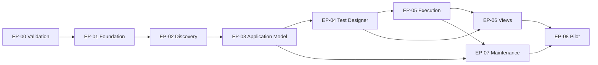

# 07 — Engineering Backlog ve Uygulama Sırası

## Çalışma kuralları

- Epic → Feature → User Story → Acceptance Criteria → Technical Tasks → Dependencies → DoD.
- Üretim kodu **Gate A/B'den sonra** başlar. Kapsam kilitlendikten sonra ilk dikey dilim uçtan uca çalışır.
- Her iterasyonda doğrulanabilir ekran + API + çalışan runner + gerçek test sonucu; sadece statik UI/servis mock'u “tamamlandı” sayılmaz.
- `P0` ilk değer kanıtı, `P1` pilot güvenilirliği, `P2` gelecekteki büyüme.

## Ön iş (koddan önce)

**EP-00 Problem/Pilot Validation — P0**  
**Amaç:** Segment ve değer hipotezini doğrula.  
**Stories:** `ST-00a` 5–8 hedef kullanıcıyla görüş; `ST-00b` 2 uygulamanın login/dashboard akışını benchmark et; `ST-00c` reusable model prototipini kağıt/Figma ile test et.  
**Kabul:** mevcut akış süresi, bakım süresi, ödeme isteği ve en az 3 red sebebi kaydedildi.  
**Dependencies:** müşteri erişimi. **Risk:** yalnız fikir sahibinin tecrübesiyle karar. **DoD:** Gate A/B değerlendirmesi yayınlandı.

## P0 — Uçtan uca ürün dilimi

**EP-01 Foundation & Tenant Access**  
**Feature:** UI/API/worker ayrı paketler, health checks, session ve org/project scoping.  
**Stories:** `ST-01a` admin proje açar; `ST-01b` editor yalnız kendi org verisini görür.  
**AC:** auth/authz negatif testleri; docker compose ile local end-to-end; versioned DB migration.  
**Technical tasks:** monorepo CI, API auth middleware, PostgreSQL schema, seed demo tenant, typed error contract.  
**Dependencies:** EP-00 Gate, mimari ADR. **Risk:** gereksiz auth/ops kapsamı. **DoD:** cross-tenant testler geçer.

**EP-02 Application Connection & Safe Discovery**  
**Feature:** staging app bağlama, same-origin pasif DOM/accessibility scan.  
**Stories:** `ST-02a` QA URL ekler; `ST-02b` sayfa/element adaylarını görür.  
**AC:** blocked URL, timeout, redirect/DNS/IP filtering; adayların kanıtı ve scan limitleri; üretim URL'sine istemsiz write yok.  
**Tasks:** allowlist validator, browser scan policy, candidate storage, review screen.  
**Dependencies:** EP-01. **Risk:** complex SPA/iframe coverage. **DoD:** onaylı login sayfasında etiketli alanlar çıkar.

**EP-03 Application Knowledge & Guided Mapping**  
**Feature:** page/element/flow graph, revision, approve/reject, guided teach.  
**Stories:** `ST-03a` QA username/password/login öğelerini onaylar; `ST-03b` Login Flow v1 tanımlar.  
**AC:** ambiguous/no-match kullanıcıya gösterilir; model revision immutable; yeni mapping adoption açık.  
**Tasks:** typed graph, element resolver, review UI, reusable flow catalog, reference checks.  
**Dependencies:** EP-02. **Risk:** aşırı karmaşık graph. **DoD:** bir flow iki testte referanslanabilir.

**EP-04 Business Test Designer & Canonical Compiler**  
**Feature:** controlled action templates, typed test model, schema validation.  
**Stories:** `ST-04a` analist login intent ekler; `ST-04b` dashboard assertion ekler; `ST-04c` draft publish eder.  
**AC:** no assertion/missing flow/missing secret publish engeli; deterministic same input → same plan; schema version.  
**Tasks:** catalog, editor, JSON Schema, version repo, compiler, capability validation.  
**Dependencies:** EP-03. **Risk:** kullanıcıya çok kısıtlı DSL. **DoD:** ilk meaningful test published.

**EP-05 Reliable Execution & Evidence**  
**Feature:** job queue, Playwright worker, run states, step results, screenshots.  
**Stories:** `ST-05a` QA run başlatır; `ST-05b` fail nedenini kanıtlarıyla görür.  
**AC:** real pass/fail/infra error ayrımı; timeout/cancel; evidence ACL; stable pinned revision; idempotent run.  
**Tasks:** queue/lease, isolated context, execution plan interpreter, evidence adapter, detail UI.  
**Dependencies:** EP-04. **Risk:** yanlış PASS, orphan worker. **DoD:** seeded bug → FAIL ve sağlam app → PASS.

**EP-06 Three Views & Usability**  
**Feature:** aynı testin business/flow/technical görünümü ve guided onboarding.  
**Stories:** `ST-06a` analist flow view üzerinden adımı görür; `ST-06b` teknik kullanıcı locator/trace inceleyebilir.  
**AC:** tek shared revision; edit sonrası görünüm senkron; empty/error/loading; temel accessibility.  
**Tasks:** projections, diagram UI, technical inspector, state/permission testing.  
**Dependencies:** EP-04/05. **Risk:** teknik detayla boğma. **DoD:** kullanıcı test sonucunu doğru açıklayabilir.

## P1 — Gerçek pilot güvenilirliği

**EP-07 Maintenance, Version & Impact**  
**Feature:** change diff, mapping suggestion, impact list ve insan onaylı adopt.  
**Stories:** `ST-07a` QA değişen locator'ı revize eder; `ST-07b` etkilenen testleri görür.  
**AC:** old revision unchanged; impacted test count; false PASS yok; signed audit; regression run.  
**Tasks:** mapping dependency graph, review queue, diff UI, targeted re-run.  
**Dependencies:** EP-03/05. **Risk:** mapping yanlış terfi. **DoD:** en az 3 tasarlanmış UI drift örneğinde güvenli davranış.

**EP-08 Pilot Operations & Basic Analytics**  
**Feature:** small suites, run history, audit, quotas, telemetry, onboarding docs.  
**Stories:** `ST-08a` QA Lead kritik 5 testi tekrar çalıştırır; `ST-08b` CTO ölçülen saat ve hata oranını görür.  
**AC:** tenant quotas; retained evidence; ölçümlü test creation/maintenance; infra vs app fail raporu.  
**Tasks:** scheduled/manual suite run (pilot ihtiyacına bağlı), retention, metrics dashboard, support flow.  
**Dependencies:** EP-05/07. **Risk:** analytics'e erken büyük yatırım. **DoD:** pilot raporları yeniden üretilebilir.

## P2 — Yalnız metrikler ve müşteri talebiyle

**EP-09** CI/CD trigger ve public API; **EP-10** rule-based drift / AI suggestions; **EP-11** API execution adapter; **EP-12** cross-browser; **EP-13** private runner/hybrid; **EP-14** Mobile; **EP-15** enterprise SSO/on-prem; **EP-16** autonomous AI araştırması (mutlaka insan-gözetimli, satış/teknik kanıt şart).

## Dependency graph

## MVP açılış testi (release acceptance)

1. Yeni editor / staging target → güvenli discovery.
2. `Login` mapping onayı + reusable flow.
3. Controlled steps + explicit dashboard visibility assertion → publish.
4. Real worker run → `passed`, step summary + evidence + exact revisions.
5. Staging'de assertion bozan değişiklik → gerçek `failed`, hiçbir healing yanlış PASS üretemiyor.
6. Yalnız locator'ı değiştiren UI değişikliği → mapping suggestion/review → yeni revision → tekrar çalıştırma.
7. Başka tenant'ın proje, artifact, secret ID'si ile erişim → 403/404.
8. Worker kill → güvenli retry/infra_error, hiç sahte PASS yok.

## Öncelikli açık ürün seçimleri (implementation öncesi)

- İlk pilot hedef web sitesi/uygulama ve kritik 3 flow.
- UI dil önceliği TR/EN.
- İlk auth sağlayıcısı ve artifact storage implementasyonu.
- Managed hosting / network policy ve tüketim limiti.
- Pilot veri saklama süresi ve onay sorumlusu.

## Epic Definition of Done (her epikte)

Functioning vertical feature; e2e demos with actual target; security negative tests; schema/API docs; clear typed error contract; telemetry; accessible empty/error states; architecture/test docs synced; no unlabelled mock/simulated responses in production paths.
